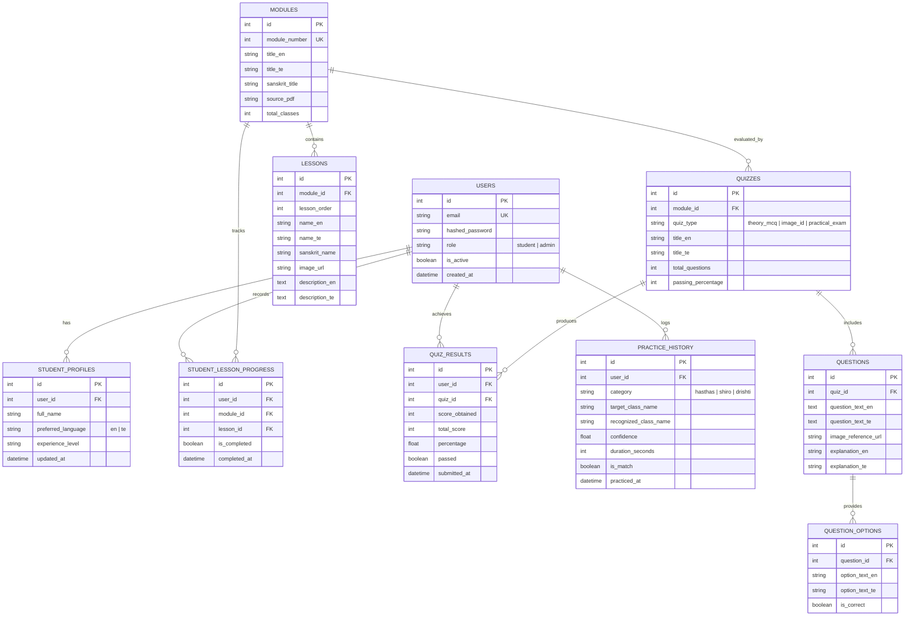

# Database Design Specification
## Project: Nritya AI – AI-Based Kuchipudi Dance Learning, Recognition & Analysis System

---

## 1. Entity-Relationship (ER) Diagram

---

## 2. Table Schemas & Data Dictionaries

### 2.1 `users` Table
| Column | Type | Constraints | Description |
| :--- | :--- | :--- | :--- |
| `id` | `INTEGER` | `PRIMARY KEY AUTOINCREMENT` | Unique user identifier |
| `email` | `VARCHAR(255)` | `UNIQUE NOT NULL` | Login email address |
| `hashed_password` | `VARCHAR(255)` | `NOT NULL` | bcrypt-hashed password hash |
| `role` | `VARCHAR(32)` | `DEFAULT 'student'` | Access role (`student` or `admin`) |
| `is_active` | `BOOLEAN` | `DEFAULT TRUE` | Account activation flag |
| `created_at` | `DATETIME` | `DEFAULT CURRENT_TIMESTAMP` | Account creation timestamp |

### 2.2 `student_profiles` Table
| Column | Type | Constraints | Description |
| :--- | :--- | :--- | :--- |
| `id` | `INTEGER` | `PRIMARY KEY AUTOINCREMENT` | Profile record identifier |
| `user_id` | `INTEGER` | `FOREIGN KEY (users.id) ON DELETE CASCADE` | Associated user reference |
| `full_name` | `VARCHAR(255)` | `NOT NULL` | Student full legal/preferred name |
| `preferred_language` | `VARCHAR(10)` | `DEFAULT 'en'` | Default language preference (`en` or `te`) |
| `experience_level` | `VARCHAR(64)` | `DEFAULT 'beginner'` | Dance experience background |
| `updated_at` | `DATETIME` | `DEFAULT CURRENT_TIMESTAMP` | Last profile update timestamp |

### 2.3 `modules` Table
| Column | Type | Constraints | Description |
| :--- | :--- | :--- | :--- |
| `id` | `INTEGER` | `PRIMARY KEY AUTOINCREMENT` | Module database ID |
| `module_number` | `INTEGER` | `UNIQUE NOT NULL` | Number ($1 \dots 7$) |
| `title_en` | `VARCHAR(255)` | `NOT NULL` | English module title |
| `title_te` | `VARCHAR(255)` | `NOT NULL` | Telugu module title |
| `sanskrit_title` | `VARCHAR(255)` | `NOT NULL` | Sanskrit title |
| `source_pdf` | `VARCHAR(255)` | `NOT NULL` | Reference PDF filename |
| `total_classes` | `INTEGER` | `NOT NULL` | Number of gestures/movements |

### 2.4 `student_lesson_progress` Table
| Column | Type | Constraints | Description |
| :--- | :--- | :--- | :--- |
| `id` | `INTEGER` | `PRIMARY KEY AUTOINCREMENT` | Progress record identifier |
| `user_id` | `INTEGER` | `FOREIGN KEY (users.id) ON DELETE CASCADE` | Student reference |
| `module_id` | `INTEGER` | `FOREIGN KEY (modules.id) ON DELETE CASCADE` | Module reference |
| `lesson_id` | `INTEGER` | `NULLABLE` | Optional specific lesson reference |
| `is_completed` | `BOOLEAN` | `DEFAULT FALSE` | Completion flag |
| `completed_at` | `DATETIME` | `DEFAULT CURRENT_TIMESTAMP` | Timestamp of completion |

### 2.5 `quiz_results` Table
| Column | Type | Constraints | Description |
| :--- | :--- | :--- | :--- |
| `id` | `INTEGER` | `PRIMARY KEY AUTOINCREMENT` | Result record identifier |
| `user_id` | `INTEGER` | `FOREIGN KEY (users.id) ON DELETE CASCADE` | Student reference |
| `quiz_id` | `INTEGER` | `FOREIGN KEY (quizzes.id) ON DELETE CASCADE` | Associated assignment |
| `score_obtained` | `INTEGER` | `NOT NULL` | Raw score achieved |
| `total_score` | `INTEGER` | `NOT NULL` | Total score possible |
| `percentage` | `FLOAT` | `NOT NULL` | Score percentage |
| `passed` | `BOOLEAN` | `NOT NULL` | Passing status ($\ge 70\%$) |
| `submitted_at` | `DATETIME` | `DEFAULT CURRENT_TIMESTAMP` | Submission timestamp |

### 2.6 `practice_history` Table
| Column | Type | Constraints | Description |
| :--- | :--- | :--- | :--- |
| `id` | `INTEGER` | `PRIMARY KEY AUTOINCREMENT` | Session log ID |
| `user_id` | `INTEGER` | `FOREIGN KEY (users.id) ON DELETE CASCADE` | Student reference |
| `category` | `VARCHAR(32)` | `NOT NULL` | `hasthas`, `shiro`, or `drishti` |
| `target_class_name` | `VARCHAR(128)` | `NOT NULL` | Gesture student attempted |
| `recognized_class_name` | `VARCHAR(128)` | `NOT NULL` | Model prediction output |
| `confidence` | `FLOAT` | `NOT NULL` | Model confidence metric |
| `duration_seconds` | `INTEGER` | `DEFAULT 0` | Duration of practice |
| `is_match` | `BOOLEAN` | `NOT NULL` | Prediction matches target |
| `practiced_at` | `DATETIME` | `DEFAULT CURRENT_TIMESTAMP` | Timestamp of practice |
