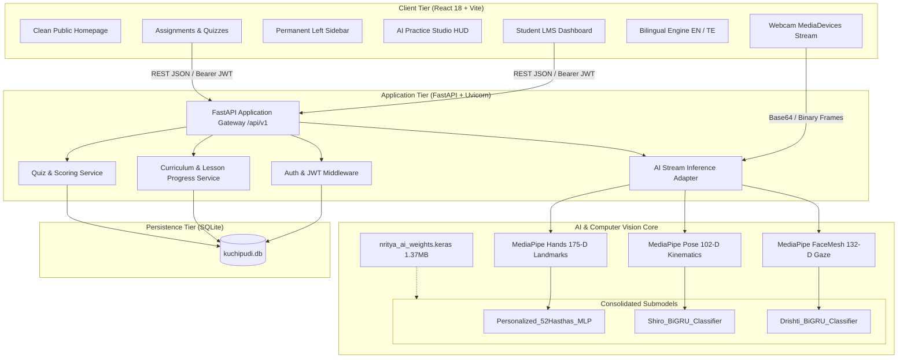
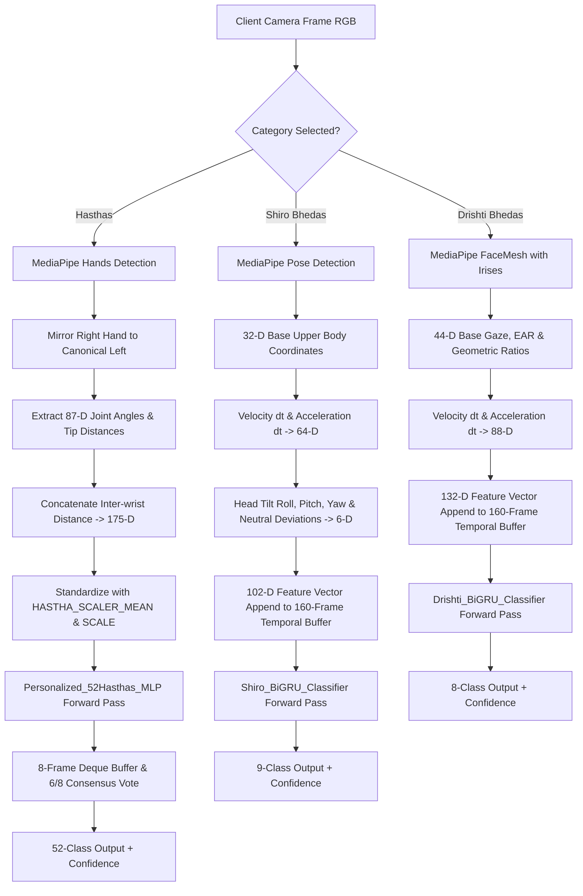

# System Architecture Document
## Project: Nritya AI – AI-Based Kuchipudi Dance Learning, Recognition & Analysis System

---

## 1. High-Level Architectural Decomposition

The system is architected as a clean, decoupled 3-tier architecture:
1. **Client Tier**: React 18 + Vite SPA delivering a bilingual UI/UX with responsive mobile/desktop LMS layouts.
2. **Application Tier**: Python 3.11 FastAPI asynchronous server delivering REST endpoints, JWT authorization, and WebSocket/REST AI inference streaming.
3. **AI & Data Tier**:
   - Consolidated TensorFlow/Keras neural network (`nritya_ai_weights.keras`).
   - MediaPipe geometric landmark extractors (Hands, Pose, FaceMesh).
   - Embedded SQLite relational database.

---

## 2. Component Details

### A. Frontend Layer (React + Vite)
- **Vite Bundler**: Hot module replacement (HMR), sub-second build times, and tree-shaken production bundles.
- **State Management**:
  - `currentLang`: Persistent bilingual dictionary manager (`en` / `te`).
  - `user`: Authenticated JWT and user profile token.
  - `completedModules`: Reactive lesson progress tracking state.
- **Styling Architecture**: Custom CSS custom-property variables adhering to the Stage 2.5 refined soft palette (Blush Ivory `#F4E8E2`, Sage Green `#D9E5D5`, Lavender `#E8DDF0`, Antique Gold `#E8D1A7`, Deep Plum `#482C3A`, Temple Green `#293C35`).

### B. Backend Layer (FastAPI)
- **Asynchronous Execution**: Native async/await event loop in Python 3.11 for concurrent API requests.
- **CORS Middleware**: Explicit origin whitelisting allowing secure communication between frontend (`localhost:3000`) and backend (`localhost:8000`).
- **Pydantic Schemas**: Strict schema typing for incoming requests (registration, login, lesson progress, quiz submissions).

### C. AI Inference Adapter (`ai_engine/`)
- Isolates inference execution from user camera devices.
- Reuses the exact mathematical feature vectors, scalers, and consensus deque gates from `deployment_clean/test.py`.
- **Pre-Compiled Graph Execution**: Employs `@tf.function(reduce_retracing=True)` graph optimization to minimize CPU inference latency ($< 25\text{ ms}$ per forward pass).

---

## 3. Real-Time AI Inference Pipeline

