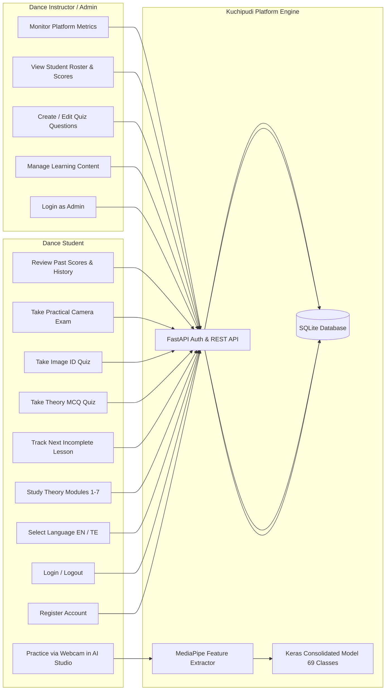
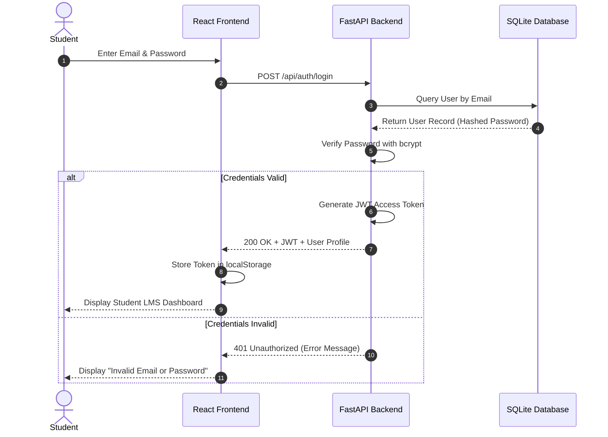
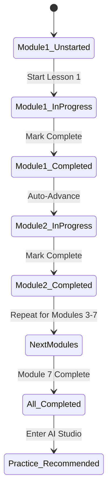
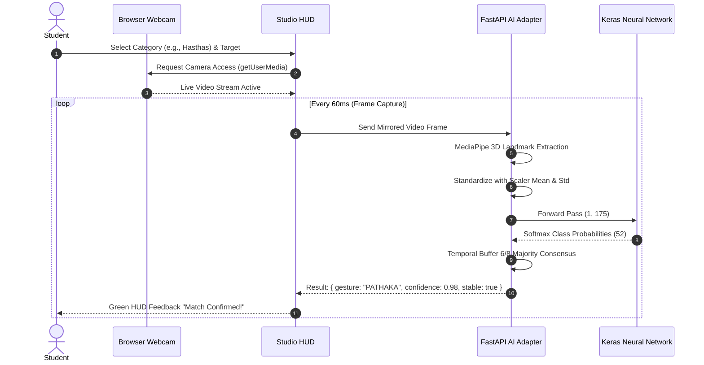

# Use Case Specifications & Workflows
## Project: Nritya AI – AI-Based Kuchipudi Dance Learning, Recognition & Analysis System

---

## 1. High-Level Use Case Diagram

---

## 2. Primary Use Case Flows

### UC-01: Student Registration & Login Flow
- **Actor**: Dance Student
- **Precondition**: User has access to web browser and internet connection.
- **Workflow**:
  1. Student navigates to the platform homepage.
  2. Student clicks "Login / Register" in the top navbar.
  3. Student enters Full Name, Email, Password, and selects preferred language (English or Telugu).
  4. System validates email uniqueness, hashes password with bcrypt, and stores record in SQLite.
  5. System generates JWT access token and initializes student session.
  6. Student is redirected to the Student Dashboard with Module 1 set as the starting point.

---

### UC-02: Learning and Dynamic Progress Flow
- **Actor**: Dance Student
- **Workflow**:
  1. Student logs into dashboard.
  2. System queries `StudentLessonProgress` table for all completed module IDs.
  3. System evaluates:
     $$\text{Next Module} = \min \{ m \in \{1 \dots 7\} \mid m \notin \text{Completed} \}$$
  4. If next module exists: System highlights it on the dashboard overview with "Resume Lesson".
  5. If all 7 are completed: System displays completion celebration and recommends AI practice.
  6. Student reviews lesson text, mudra illustrations, and Sanskrit definitions.
  7. Student clicks "Mark Lesson Complete".
  8. System writes record to SQLite, updates progress bar, and re-evaluates next incomplete lesson.

---

### UC-03: Real-Time AI Camera Practice Flow
- **Actor**: Dance Student
- **Precondition**: Webcam connected and browser permission granted.
- **Workflow**:
  1. Student opens Practice Studio and selects category:
     - **A. Hasthas (52 classes)**
     - **B. Shiro Bhedhas (9 classes)**
     - **C. Drishti Bhedhas (8 classes)**
  2. Student selects target mudra or movement (e.g. *Pathaka Hasta*).
  3. Video feed renders in the viewport with alignment guides.
  4. Video frames are captured and transferred to the backend inference service.
  5. Feature extractor generates normalized vectors:
     - 175-D for Hastas (MediaPipe Hands)
     - 102-D for Shiro (MediaPipe Pose velocity & angles)
     - 132-D for Drishti (MediaPipe FaceMesh gaze kinematics)
  6. Model performs forward pass through `nritya_ai_weights.keras`.
  7. Stabilization gate aggregates temporal consensus (6 out of 8 frames).
  8. Recognized gesture name, confidence, and match feedback appear on the HUD.

---

### UC-04: Assignment & Examination Flow
- **Actor**: Dance Student
- **Workflow**:
  1. Student selects assignment: Theory MCQ, Image ID, or Practical Exam.
  2. System loads questions or authentic test images from the curriculum database.
  3. Student submits answers.
  4. Server calculates score and writes to `StudentQuizResults` table.
  5. Student receives score percentage, correct answer review, and explanations.
  6. Student dashboard metrics update automatically.
